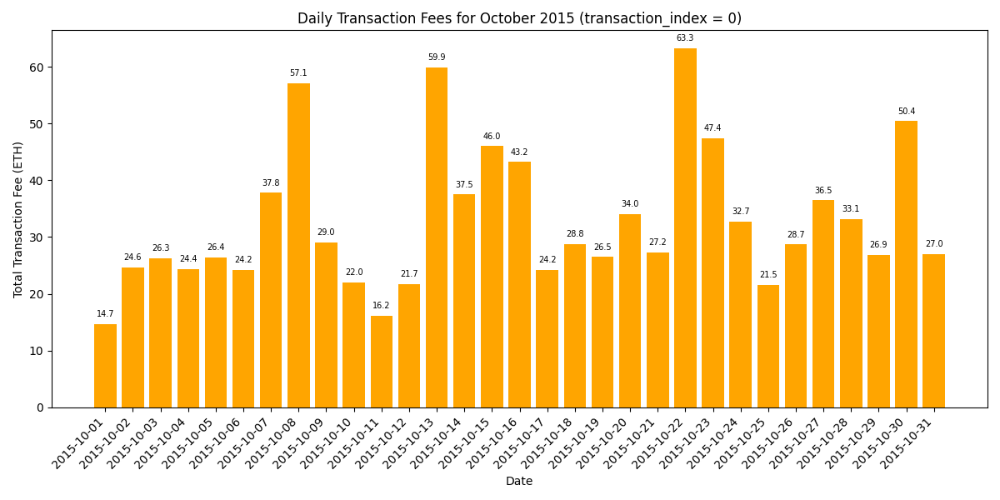
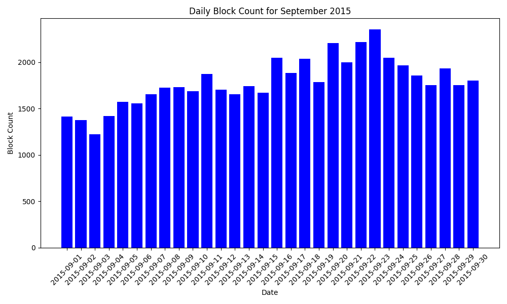

# pyspark-case-studies

Four standalone PySpark jobs written against a Hadoop/S3 cluster during my MSc at Queen Mary University of London. Each reads from S3 over s3a, takes all configuration (bucket, endpoint, credentials) from environment variables, and writes results back to a bucket. Cluster-run output CSVs and the derived figures are included.

| Script | Dataset | What it does |
|---|---|---|
| `nyc_taxi_analysis.py` | NYC Yellow Taxi, 2023 | Joins trip data against the zone lookup table, builds borough-to-borough routes, and aggregates route popularity by month plus daily totals |
| `ethereum_analysis.py` | Ethereum blocks + transactions | Blocks mined and unique senders per day for September 2015, and the full transaction-fee breakdown for October 2015 |
| `taxi_graph_analysis.py` | NYC Green Taxi, 2023 | Builds a pickup/dropoff zone graph with GraphFrames, then runs connected components, shortest paths, and PageRank over it |
| `nasa_log_streaming.py` | NASA HTTP server logs | Structured Streaming with watermarking: windowed counts over a simulated log stream, late-data handling, and per-batch tracking |

## Sample results

October 2015 Ethereum transaction fees, computed from the full transactions table: 1,019 ETH total for the month, averaging 32.9 ETH per day, peaking at 63.3 ETH on October 22.





The GraphFrames job's outputs are in [`outputs/taxi_graph/`](outputs/taxi_graph/): connected components, shortest paths from a chosen zone, and the PageRank ranking of pickup/dropoff zones. The Ethereum CSVs behind the figures are in [`outputs/ethereum/`](outputs/ethereum/), and `plot_ethereum.py` regenerates the figures from them.

## Running

The jobs expect a Spark 3 cluster (the graph job pulls `graphframes:0.8.2-spark3.2` via `spark.jars.packages`) and this environment:

```
DATA_REPOSITORY_BUCKET   # bucket holding the source datasets
BUCKET_NAME              # bucket for results
S3_ENDPOINT_URL
BUCKET_PORT
AWS_ACCESS_KEY_ID
AWS_SECRET_ACCESS_KEY
```

```bash
spark-submit nyc_taxi_analysis.py
spark-submit taxi_graph_analysis.py
spark-submit nasa_log_streaming.py
spark-submit ethereum_analysis.py
```

Dataset paths inside the scripts assume a `data/` prefix in the repository bucket; adjust to your layout. No credentials are hardcoded anywhere.
